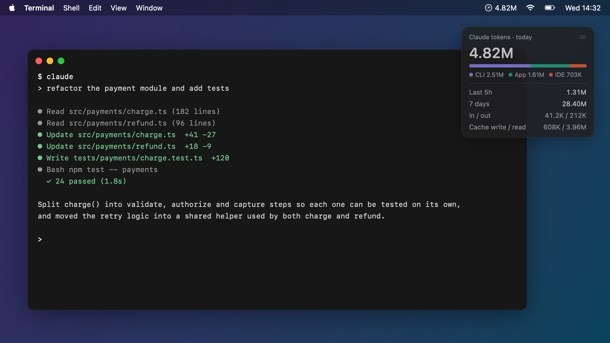
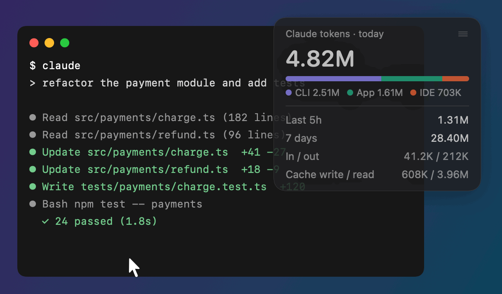
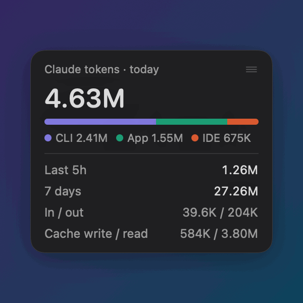
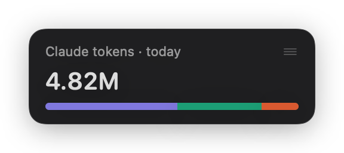

# Claude Token Overlay

A small, translucent, always-on-top overlay that tracks your Claude Code token usage across every local client: the CLI, the Claude desktop app's Code tab, and IDE extensions (VS Code, JetBrains). Works on macOS and Windows.

It reads the session logs those clients write to `~/.claude/projects` (on Windows `%USERPROFILE%\.claude\projects`; also `~/.config/claude/projects` and `$CLAUDE_CONFIG_DIR`). Nothing leaves your machine.

**[Try it in your browser →](https://abhairenjith.github.io/TokenOverlay/)** drag it, hover it, click the number, change the opacity.



<p>
  
</p>
<p>
  
  
</p>

<sub>Images are rendered from the app's own view with sample numbers (macOS). Regenerate with `TokenOverlay --render-screenshots docs` (after `macos/build.sh --install`).</sub>

## What it shows

- Total tokens for today, the last 5 hours, or the last 7 days (click the number to switch)
- A bar split by client: CLI, App, IDE
- Input / output and cache write / cache read breakdown

## macOS

Native Swift app with a menu bar icon. Needs macOS 14+ and the Xcode command line tools (`xcode-select --install`).

```bash
git clone https://github.com/abhaiRenjith/TokenOverlay.git
cd TokenOverlay/macos
./build.sh --install --run
```

Cloning only downloads the source; `build.sh` compiles the app. `--install` copies it to `~/Applications` (set `APP_DIR` to pick another folder), sets it to open with every Claude Code session, and links it as a `TokenOverlay` command in `~/.local/bin` (no sudo; set `INSTALL_DIR` to change) and tells you if that folder is not on your `PATH`. `--run` opens the overlay. Without `--install`, run the binary by its full path: `"macos/Claude Token Overlay.app/Contents/MacOS/TokenOverlay"`.

Settings live in the menu bar icon: opacity, opacity on hover, click-through, compact mode, count in the menu bar, launch with Claude, launch at login, reset position.

## Windows

Python script with no dependencies beyond the standard library. Needs Python 3.8+ from [python.org](https://www.python.org/downloads/) (tick "Add python.exe to PATH").

```bat
git clone https://github.com/abhaiRenjith/TokenOverlay.git
cd TokenOverlay\windows
install.bat
```

`install.bat` copies the overlay to `%LOCALAPPDATA%\Programs\ClaudeTokenOverlay`, adds **Claude Token Overlay** to the Start menu, sets it to open with every Claude Code session, and starts it. It needs no admin rights. Run it again to update; `install.bat -Uninstall` removes it. To try it without installing, use `run.bat`.

It runs without a console window, even if you start it with `python token_overlay.py` or a double-click, and only one copy runs at a time. If it fails to start, it shows a message and writes details to `%APPDATA%\ClaudeTokenOverlay\error.log`.

Right-click the overlay for settings: period, opacity, compact mode, click-through, launch with Claude, launch at login, reset position. With click-through on, hold Ctrl to drag or right-click it again.

## Both

- **Launch with Claude**: the installers add a `SessionStart` hook to `~/.claude/settings.json` (or `$CLAUDE_CONFIG_DIR`), so the overlay opens whenever you start a Claude Code session in the CLI, the desktop app's Code tab or an IDE extension. If it is already open, nothing happens. Turn it off from the overlay's menu, or with `--uninstall-hook`. Other hooks in that file are left alone; the first change saves a copy as `settings.json.before-token-overlay`.
- Drag the overlay to move it; the position is remembered. If that spot is on a display that is no longer connected, it opens in the top-right corner instead.
- `--dump` prints the totals to the terminal and exits (`TokenOverlay --dump` on macOS after `./build.sh --install`, `python token_overlay.py --dump` on Windows).

## Notes

- Ordinary claude.ai chats (outside the Code tab) keep no local log and are not counted.
- Each request resends the conversation, so cache reads usually dominate the total. They cost about a tenth of normal input tokens.
- It counts tokens; it does not show the remaining quota on your plan.

## License

MIT

## Demo page

`docs/index.html` is the browser demo. To publish it, open the repo on GitHub → Settings → Pages, and set the source to the `main` branch, `/docs` folder.
